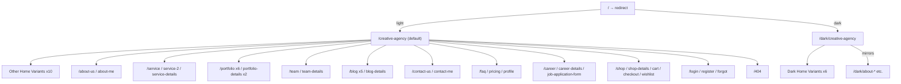
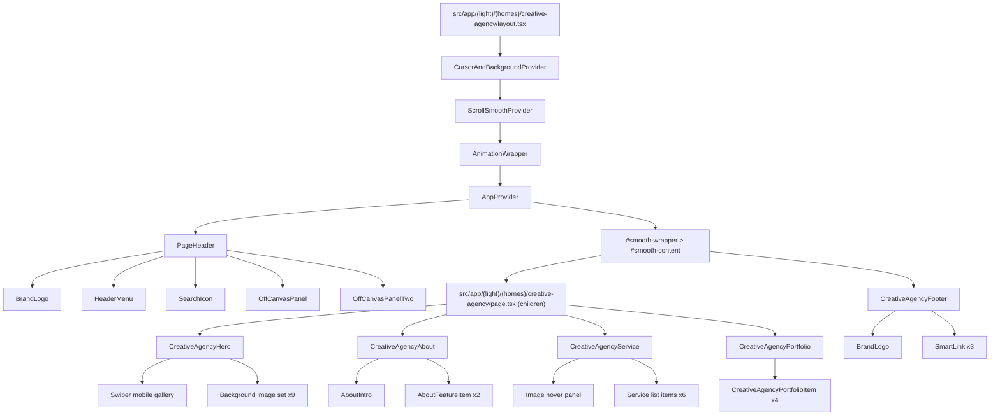

# Architecture — cunnet-nextjs

> Generated from code analysis. Every claim is cited to a source file.  
> Template origin confirmed: **"Cunnet - Creative Portfolio Agency Nextjs Template"** by **aqlova / ThemePure** (`public/assets/scss/theme/_theme.scss` header comment, `src/layouts/footers/CreativeAgencyFooter.tsx` copyright line).

---

## 1. Project Overview

**Purpose:** A multi-variant creative-agency / portfolio marketing site. The codebase ships every demo page from the purchased template. Intended end-state is a single business (Crescita Software) customised from the template.

**Audience:** Prospective clients of a creative/digital agency; also developers customising the template.

### Tech-stack table

| Layer | Library | Version | Primary location |
|---|---|---|---|
| Framework | Next.js | 16.1.6 | `next.config.ts`, `src/app/` |
| UI runtime | React | 19.2.3 | all `*.tsx` |
| Language | TypeScript | ^5 | `tsconfig.json` |
| CSS framework | Bootstrap | ^5.3.8 | `public/assets/css/bootstrap.min.css`, `src/app/globals.scss` |
| CSS pre-processor | Sass | ^1.97.2 | `public/assets/scss/` |
| Animation (primary) | GSAP + ScrollSmoother + SplitText | ^3.14.2 | `src/hooks/useGsapAnimation.ts`, `src/hooks/useScrollSmooth.ts` |
| GSAP React adapter | @gsap/react | ^2.1.2 | `src/hooks/useScrollSmooth.ts`, `AnimationWrapper.tsx` |
| Animation (secondary) | Framer Motion | ^12.24.11 | 6 portfolio filter components only |
| WebGL image hover | hover-effect | ^1.2.1 | `src/hooks/useGsapAnimation.ts` → `tpHoverWebGL` |
| Carousel / slider | Swiper | ^12.0.3 | hero, testimonial, blog, portfolio sliders |
| Photo lightbox | react-photo-view | ^1.2.7 | `src/provider/PhotoProviderWrapper.tsx`, offcanvas gallery, portfolio mix |
| Forms | react-hook-form | ^7.70.0 | all `src/components/form/*.tsx` |
| Toast notifications | react-toastify | ^11.0.5 | `src/app/layout.tsx` (`<ToastContainer />`), form submit handlers |
| Utility hooks | react-use | ^17.6.0 | `NiceSelect.tsx` (`useClickAway`) |
| Fonts (runtime) | next/font/google (Inter, Jost) | — | `src/app/layout.tsx` |
| Fonts (local) | Sequel Sans (5 cuts, woff2/woff) | — | `public/assets/fonts/`, `public/assets/scss/utils/_typography.scss` |
| Tooltip popper | @popperjs/core | ^2.11.8 | Bootstrap dependency; no direct usage found |
| Linter | ESLint 9 + eslint-config-next | ^9 | `eslint.config.mjs` |

---

## 2. Routing & Page Inventory

**Router type:** App Router (`src/app/`). No `src/pages/` directory exists.

**Root redirect:** `src/app/page.tsx` → `redirect("/creative-agency")`.  
**Dark root redirect:** `src/app/dark/page.tsx` → `redirect("/dark/creative-agency")`.

### Light pages (`src/app/(light)/`)

| Path | File | Purpose | Key sections / components |
|---|---|---|---|
| `/creative-agency` | `(homes)/creative-agency/page.tsx` | **Default home** | Hero, About, Service, Portfolio |
| `/digital-studio` | `(homes)/digital-studio/page.tsx` | Home variant 2 | DigitalStudioHero, portfolio zoom |
| `/modern-agency` | `(homes)/modern-agency/page.tsx` | Home variant 3 | Magnetic hero, awards |
| `/personal-portfolio` | `(homes)/personal-portfolio/page.tsx` | Home variant 4 | PersonalPortfolioHero, WebGL hover |
| `/branding-studio` | `(homes)/branding-studio/page.tsx` | Home variant 5 | BrandingStudioHero |
| `/motion-graphic` | `(homes)/motion-graphic/page.tsx` | Home variant 6 | MotionGraphicHero, panel-pin |
| `/agency-shop` | `(homes)/agency-shop/page.tsx` | Home variant 7 (shop) | ShopHero, products |
| `/portfolio-creative-skew-slider` | `(homes)/portfolio-creative-skew-slider/page.tsx` | Home variant 8 | Skew slider hero |
| `/portfolio-creative-thumb-slider` | `(homes)/portfolio-creative-thumb-slider/page.tsx` | Home variant 9 | Thumb slider hero |
| `/portfolio-mix-slicer` | `(homes)/portfolio-mix-slicer/page.tsx` | Home variant 10 | Mix slicer with lightbox |
| `/portfolio-revealing-slider` | `(homes)/portfolio-revealing-slider/page.tsx` | Home variant 11 | WebGL reveal slider |
| `/about-us` | `(about)/about-us/page.tsx` | Agency about | Intro, marquee, awards, team |
| `/about-me` | `(about)/about-me/page.tsx` | Personal about | Marquee, char animation |
| `/service` | `(services)/service/page.tsx` | Services list | Panel pin, service cards |
| `/service-2` | `(services)/service-2/page.tsx` | Services alt | Char animation variant |
| `/service-details` | `(services)/service-details/page.tsx` | Service detail | Single service content |
| `/portfolio` | `(portfolios)/portfolio/page.tsx` | Portfolio grid | 2-col filterable |
| `/portfolio-2` | `(portfolios)/portfolio-2/page.tsx` | Portfolio alt | Tab filter |
| `/portfolio-3` | `(portfolios)/portfolio-3/page.tsx` | Portfolio alt 2 | Tab filter |
| `/portfolio-4` | `(portfolios)/portfolio-4/page.tsx` | Portfolio alt 3 | Tab filter |
| `/portfolio-col-3` | `(portfolios)/portfolio-col-3/page.tsx` | Portfolio 3-col | Tab filter |
| `/portfolio-col-4` | `(portfolios)/portfolio-col-4/page.tsx` | Portfolio 4-col | Tab filter |
| `/portfolio-details` | `(portfolios)/portfolio-details/page.tsx` | Project detail | Case study layout |
| `/portfolio-details-gallery` | `(portfolios)/portfolio-details-gallery/page.tsx` | Project gallery | Marquee + react-photo-view |
| `/team` | `(team)/team/page.tsx` | Team grid | WebGL hover, team cards |
| `/team-details` | `(team)/team-details/page.tsx` | Team member detail | Profile, contact form |
| `/blog` | `(blogs)/blog/page.tsx` | Blog grid | WebGL hover on cards |
| `/blog-standard` | `(blogs)/blog-standard/page.tsx` | Blog standard | List layout |
| `/blog-list` | `(blogs)/blog-list/page.tsx` | Blog list | Compact list |
| `/blog-grid-with-sidebar` | `(blogs)/blog-grid-with-sidebar/page.tsx` | Blog + sidebar | Grid + sidebar |
| `/blog-details` | `(blogs)/blog-details/page.tsx` | Post detail | Postbox, comments, form |
| `/contact-us` | `(contact)/contact-us/page.tsx` | Agency contact | Map, form, info |
| `/contact-me` | `(contact)/contact-me/page.tsx` | Personal contact | Simpler form |
| `/faq` | `faq/page.tsx` | FAQ accordion | Bootstrap accordion |
| `/pricing` | `pricing/page.tsx` | Pricing toggle | Monthly/yearly toggle |
| `/profile` | `profile/page.tsx` | User profile | Personal details, password |
| `/career` | `(career)/career/page.tsx` | Careers list | Job cards |
| `/career-details` | `(career)/career-details/page.tsx` | Job detail | Sidebar pin animation |
| `/job-application-form` | `(career)/job-application-form/page.tsx` | Application | Job application form |
| `/shop` | `(shop)/shop/page.tsx` | Shop listing | Product grid, filter |
| `/shop-details` | `(shop)/shop-details/page.tsx` | Product detail | Gallery, reviews form |
| `/cart` | `(shop)/cart/page.tsx` | Cart | Quantity controls |
| `/checkout` | `(shop)/checkout/page.tsx` | Checkout | Billing form |
| `/wishlist` | `(shop)/wishlist/page.tsx` | Wishlist | Product list |
| `/login` | `(auth)/login/page.tsx` | Login | Auth form |
| `/register` | `(auth)/register/page.tsx` | Register | Auth form |
| `/forgot` | `(auth)/forgot/page.tsx` | Password reset | Auth form |
| `/404` | `(light)/404/page.tsx` | Custom 404 | Error illustration |

### Dark pages (`src/app/dark/`)

All 7 home variants and all inner pages are mirrored under `/dark/*`. The `dark/layout.tsx` adds/removes class `cunnet-dark` on `<html>` via `useEffect`. Dark pages share the same components as light; styles are overridden by `.cunnet-dark` selectors in `public/assets/scss/layout/pages/_dark.scss`.

### Sitemap (Mermaid)



---

## 3. Directory Structure

```
src/
├── app/                        # Next.js App Router root
│   ├── layout.tsx              # Root layout: fonts (Inter, Jost), ToastContainer, globals.scss
│   ├── page.tsx                # Redirects → /creative-agency
│   ├── globals.scss            # SCSS entry: @forward Bootstrap, spacing, font-awesome, main.scss,
│   │                           #   react-toastify, react-photo-view. Global CSS vars + utility classes.
│   ├── error.tsx               # Global error boundary
│   ├── not-found.tsx           # Next.js 404 handler
│   ├── favicon.ico
│   ├── (light)/                # Route group: all light-theme pages (no URL segment)
│   │   ├── (homes)/            # Home page variants (11 sub-routes)
│   │   ├── (about)/            # about-me, about-us
│   │   ├── (services)/         # service, service-2, service-details
│   │   ├── (portfolios)/       # 8 portfolio routes
│   │   ├── (team)/             # team, team-details
│   │   ├── (blogs)/            # 5 blog routes
│   │   ├── (contact)/          # contact-me, contact-us
│   │   ├── (career)/           # career, career-details, job-application-form
│   │   ├── (shop)/             # shop, shop-details, cart, checkout, wishlist
│   │   ├── (auth)/             # login, register, forgot
│   │   ├── 404/
│   │   ├── faq/
│   │   ├── pricing/
│   │   └── profile/
│   └── dark/                   # Dark-theme mirror
│       ├── layout.tsx          # "use client" — adds/removes .cunnet-dark on <html>
│       ├── page.tsx            # Redirects → /dark/creative-agency
│       └── (same sub-groups as light)
│
├── components/                 # All reusable UI components
│   ├── about/                  # AboutIntro, CreativeAgencyAbout, AboutFeatureItem, etc.
│   ├── award/                  # Award list components
│   ├── banner/                 # CTA banner components
│   ├── blog/                   # Blog grid, list, standard, sidebar
│   ├── brand/                  # Brand logo sliders
│   ├── breadcrumb/             # Page breadcrumb
│   ├── career/                 # Career list, details, sidebar
│   ├── cart/                   # MiniCart sidebar
│   ├── common/                 # BrandLogo, SmartLink, TypewriterWords, BackToTop util
│   ├── contact/                # ContactUsForm, ContactMeArea, map
│   ├── cta/                    # Call-to-action sections
│   ├── faq/                    # FAQ accordion
│   ├── form/                   # 15 react-hook-form forms
│   ├── funfact/                # Counter/stats section
│   ├── gallery/                # Gallery grid components
│   ├── hero/                   # 8 hero components (one per home variant)
│   ├── layout/                 # HeaderMenu, MobileMenus, StickyMainMenu
│   ├── offcanvus/              # OffCanvasPanel, OffCanvasPanelTwo
│   ├── overview/               # Project overview sections
│   ├── popup/                  # ShopSubscribePopup
│   ├── portfolio/              # 10+ portfolio components + subComponents/
│   ├── pricing/                # PricingArea, ServicePricing
│   ├── process/                # Process steps
│   ├── product/                # Shop product components
│   ├── profile/                # Profile page sections
│   ├── resume/                 # About-me resume section
│   ├── service/                # CreativeAgencyService, ServiceArea, etc.
│   ├── shared/
│   │   ├── animation/          # AnimationWrapper.tsx (GSAP orchestrator)
│   │   ├── BackToTop/          # Scroll-to-top button
│   │   └── Counter/            # Animated counter
│   ├── shop/                   # Cart, checkout, wishlist area components
│   ├── skill/                  # Skill bar components
│   ├── team/                   # Team grid and detail components
│   └── testimonial/            # Testimonial sliders
│
├── config/
│   └── animationConfig.ts      # Route → GSAP animation function map (31 routes)
│
├── constant/
│   └── swiper.ts               # All Swiper config objects (params)
│
├── data/                       # Static data files (TS arrays/objects — no DB)
│   ├── awards-data.ts
│   ├── blog-data.ts
│   ├── career-data.ts
│   ├── faq-data.ts
│   ├── footer-data.ts          # QUICK_LINKS, SOCIAL_LINKS, footerMenuData
│   ├── portfolio-data.ts       # 82 portfolio items
│   ├── portfolio-data-two.ts   # Filter tab definitions
│   ├── pricing-data.ts
│   ├── product-data.ts
│   ├── service-data.ts
│   ├── team-data.ts
│   └── testimonial-data.ts
│
├── hooks/                      # Custom React hooks
│   ├── useContext.ts           # Reads AppContext
│   ├── useCursorAndBackground.ts # Custom cursor DOM manipulation
│   ├── useGsapAnimation.ts     # All GSAP animation functions (exported individually)
│   ├── useHeaderMenu.ts        # Menu open/close state logic
│   ├── useScrollSmooth.ts      # GSAP ScrollSmoother setup (useGSAP)
│   ├── useSkewSlider.ts        # Skew portfolio slider
│   ├── useSlideshowPortfolio.ts # Portfolio slideshow
│   └── useStickyHeader.ts      # Scroll > threshold → sticky boolean
│
├── layouts/
│   ├── BootstrapLoader.tsx     # "use client" — initialises Bootstrap JS
│   ├── footers/                # 7 footer variants (per-home)
│   └── headers/                # 6 header variants + subComponents/
│
├── plugin/
│   └── (SwiperGL plugin)       # SwiperGL WebGL plugin wrapper
│
├── provider/
│   ├── AppProvider.tsx         # "use client" — global state: offcanvas, search, miniCart
│   ├── CustomCursorProvider.tsx # "use client" — cursor init
│   ├── PhotoProviderWrapper.tsx # "use client" — react-photo-view context
│   ├── ScrollSmoothProvider.tsx # "use client" — calls useScrollSmooth
│   └── VideoProvider.tsx       # "use client" — video modal state + render
│
├── svg/                        # Inline SVG icon components
│   └── ArrowIcons, StarIcons, SearchIcons, ServiceIcons, ShopIcons, etc.
│
├── types/                      # TypeScript interfaces
│   ├── animation.types.ts
│   ├── custom-dt.ts            # AppContextType, ImageDT, FooterSectionDT
│   ├── header-dt.ts            # PageHeaderProps
│   ├── portfolio-dt.ts
│   ├── product-dt.ts
│   ├── service-dt.ts
│   ├── team-dt.ts
│   └── hover-effect.d.ts       # Type shim for hover-effect package
│
├── ui/
│   └── NiceSelect.tsx          # "use client" — custom dropdown (uses react-use/useClickAway)
│
└── utils/
    ├── cursorAnimation.ts      # rAF-based cursor position tracker
    └── getCurrentYear.ts       # Returns current year (used in footers)

public/
└── assets/
    ├── css/
    │   ├── bootstrap.min.css   # Bootstrap 5.3 compiled CSS (vendored)
    │   ├── font-awesome-pro.css# Font Awesome Pro (vendored, requires licence)
    │   └── spacing.css         # Utility spacing classes
    ├── fonts/                  # Sequel Sans woff2/woff (locally hosted, proprietary)
    ├── img/                    # All raster images (jpg, png, svg)
    │   └── (30+ sub-folders: about, blog, hero, portfolio, service, team, etc.)
    └── scss/                   # SCSS source (processed via globals.scss @forward)
        ├── main.scss           # Entry: @forward theme, components, layout
        ├── utils/              # _colors.scss, _variables.scss, _typography.scss,
        │                       # _breakpoints.scss, _root.scss, _mixins.scss, _extends.scss
        ├── theme/              # _theme.scss (base reset + typography), _common.scss, _spacing.scss
        ├── components/         # _buttons.scss, _cursor.scss, _animation.scss, _section-title.scss, etc.
        └── layout/
            ├── header/, footer/, blog/, menu/
            └── pages/          # Per-section SCSS: _hero.scss, _service.scss, _dark.scss, etc.
```

---

## 4. Layout & Composition

### Root layout (`src/app/layout.tsx`)

```
<html lang="en">
  <body class="{--font-inter} {--font-jost}">
    {children}          ← page-level layouts nest here
    <ToastContainer />  ← react-toastify, always mounted
  </body>
</html>
```

- Loads `globals.scss` (Bootstrap + spacing + Font Awesome + Sequel Sans + Swiper CSS + toastify CSS + react-photo-view CSS).
- Loads Inter and Jost via `next/font/google` with `preload: false` (lazy).
- Defines site-wide `<Metadata>` title/description.

### Per-home layout (example: `src/app/(light)/(homes)/creative-agency/layout.tsx`)

```
CursorAndBackgroundProvider          ← cursor DOM setup (client)
  ScrollSmoothProvider               ← GSAP ScrollSmoother init (client)
    AnimationWrapper                 ← GSAP route-based animation orchestrator (client)
      AppProvider                    ← React context: offcanvas, search, cart state (client)
        <div id="magic-cursor">      ← cursor element
        <BackToTop />
        <HeaderSearch />             ← search overlay
        <PageHeader />               ← main nav header
        <div id="smooth-wrapper">
          <div id="smooth-content">
            {children}               ← page.tsx content
            <CreativeAgencyFooter />
```

Different home variants swap out the header and footer components but keep this provider shell.

### Dark layout (`src/app/dark/layout.tsx`)

A thin `"use client"` wrapper that runs `useEffect` to add/remove the class `cunnet-dark` on `document.documentElement`. Every dark inner page then inherits the same per-home layout as its light counterpart, but all CSS selectors inside `.cunnet-dark { … }` in `_dark.scss` take effect.

### Navigation

**Desktop:** `PageHeader` renders `HeaderMenu` (dropdown nav via `useHeaderMenu`). The main menu is only shown on `≥xl` (1200px). Below that, a hamburger button opens the offcanvas.

**Offcanvas:** Two panels:
- `OffCanvasPanel` — full navigation + photo gallery + contact info.
- `OffCanvasPanelTwo` — hamburger-style secondary menu, used by variants that set `useSecondaryMenu={true}`.

**Sticky header:** A separate floating hamburger button (`#header-sticky`) appears via `useStickyHeader` (scroll > 20px).

**SmartLink** (`src/components/common/SmartLink.tsx`): Wraps Next.js `<Link>`. Reads `usePathname()` — if the current path starts with `/dark`, it automatically prepends `/dark` to all internal href values. This is the key mechanism that makes all in-page links "just work" regardless of which theme is active.

### Metadata / SEO

- Root metadata in `src/app/layout.tsx`: `title: "Cunnet - Creative Portfolio Agency Nextjs Template"`, `description: "A modern creative portfolio and agency Next.js template."`.
- Individual pages override with `export const metadata: Metadata = { title: "…" }`.
- No `og:` tags, `robots.txt`, or `sitemap.xml` found.

---

## 5. Component Architecture

### Component inventory

| Type | Component | Props/notes | Reuse |
|---|---|---|---|
| **Layout** | `PageHeader` | `hideMainMenu`, `sideColumnClass`, `useSecondaryMenu`, `styleVariant`, `logoType` | ~11 home layouts |
| **Layout** | `OffCanvasPanel` | no props — reads AppContext | 1 per page |
| **Layout** | `OffCanvasPanelTwo` | no props — reads AppContext | 1 per page |
| **Layout** | `AnimationWrapper` | `children` | 1 per home layout |
| **Layout** | `AppProvider` | `children` | 1 per home layout |
| **Layout** | `ScrollSmoothProvider` | `children` | 1 per home layout |
| **Layout** | `CursorAndBackgroundProvider` | `children`, `bgColor?` | 1 per home layout |
| **Layout** | `VideoProvider` | `children` | used in some layouts |
| **Section — Hero** | `CreativeAgencyHero` | no props — hardcoded gallery items | 1 |
| **Section — Hero** | `BrandingStudioHero` | — | 1 |
| **Section — Hero** | `DigitalStudioHero` | — | 1 |
| **Section — Hero** | `ModernAgencyHero` | — | 1 |
| **Section — Hero** | `MotionGraphicHero` | — | 1 |
| **Section — Hero** | `PersonalPortfolioHero` | — | 1 |
| **Section — Hero** | `PortfolioHero` | — | 1 |
| **Section — Hero** | `ShopHero` | — | 1 |
| **Section** | `CreativeAgencyAbout` | hardcoded `features[]` | 1 |
| **Section** | `CreativeAgencyService` | reads `servicesData` (slice 0–5) | 1 |
| **Section** | `CreativeAgencyPortfolio` | reads `portfolioData` (slice 0–3) | 1 |
| **UI — Form** | `ContactUsForm` | react-hook-form, toast only | 1 |
| **UI — Form** | `ContactMeForm` | react-hook-form, toast only | 1 |
| **UI — Form** | `JobApplicationForm` | react-hook-form | 1 |
| **UI — Form** | `BlogCommentForm` | react-hook-form | 1 |
| **UI — Form** | `LoginForm`, `RegisterForm`, `ForgotPassForm` | react-hook-form, no auth backend | 1 each |
| **UI — Form** | `BillingDetailsForm`, `CouponForm`, `CheckoutLoginForm` | react-hook-form, no backend | 1 each |
| **UI** | `SmartLink` | `href`, `className`, `onClick`, `children` | ~50+ instances |
| **UI** | `BrandLogo` | `logo1Width`, `logo1Height`, `logo2Width`, `logo2Height` | ~10 |
| **UI** | `TypewriterWords` | uses `framer-motion` | some heroes |
| **UI** | `NiceSelect` | custom dropdown (react-use/useClickAway) | shop pages |
| **Animation** | `AnimationWrapper` | `children` | 1 per layout |
| **Animation** | `PhotoProviderWrapper` | `children` | 2 |
| **Animation** | `VideoProvider` | `children` | some layouts |

### Home page component hierarchy (Mermaid)



---

## 6. Styling Architecture

### How Bootstrap and Sass are combined

`src/app/globals.scss` uses `@forward` to load, in order:
1. `public/assets/css/bootstrap.min.css` — compiled Bootstrap 5.3 (vendored, not via npm import)
2. `public/assets/css/spacing.css` — utility spacing helpers
3. `public/assets/css/font-awesome-pro.css` — icon font (vendored)
4. `public/assets/scss/main.scss` — project SCSS

The project SCSS uses Bootstrap's **grid and utility classes** but does **not** import Bootstrap source SCSS. All customisation is via additional classes on top, not Bootstrap variable overrides.

Bootstrap CSS variables (`--bs-*`) are present but project styles use custom `--tp-*` CSS variables exclusively.

### SCSS file organisation

```
public/assets/scss/
├── main.scss              @forward theme, components, layout
├── utils/                 Design tokens and helpers
│   ├── _colors.scss       Color map → generates --tp-* CSS vars
│   ├── _typography.scss   @font-face for Sequel Sans; font-family map; font-size map
│   ├── _variables.scss    $theme-prifix: 'tp'
│   ├── _breakpoints.scss  8 breakpoint variables (string media queries)
│   ├── _root.scss         Iterates maps → writes :root { --tp-ff-* } + { --tp-*-* }
│   ├── _mixins.scss       tp-transition, tp-transform, tp-background, keyframes, tp-gradient, bgborder
│   └── _extends.scss      %transition placeholder
├── theme/
│   ├── _theme.scss        Global reset, body/heading/input base styles
│   ├── _common.scss       z-index helpers, gutter overrides (.gx-*), font utility classes
│   └── _spacing.scss      Margin/padding utility overrides
├── components/
│   ├── _buttons.scss      All .tp-btn variants (see §3.1 of design analysis)
│   ├── _animation.scss    CSS keyframes: bar_anim, levitate-lg, rotate-infinite, tpshake, animate-pulse, arrowLineRotation
│   ├── _cursor.scss       Magic cursor styles (#magic-cursor, #ball, .ball-view, .ball-drag)
│   ├── _section-title.scss .tp-section-title (82px), .ca-section-title (60px), .cs-section-title (132px)
│   └── … (10 more files)
└── layout/
    ├── header/, footer/, blog/, menu/
    └── pages/             Per-section files: _hero.scss, _service.scss, _dark.scss, etc.
```

### CSS custom properties (`--tp-*`)

Generated at build time by `_root.scss` iterating the color and font-family Sass maps:

| Variable | Value | Role |
|---|---|---|
| `--tp-common-black` | `#1e1e1e` | Primary text, backgrounds |
| `--tp-common-white` | `#FFFFFF` | Reversed text, light surfaces |
| `--tp-common-bubbles` | `#e1eeb7` | Shop CTA button background |
| `--tp-grey-1` | `#5e5959` | Body paragraph text |
| `--tp-grey-2` | `#f3f3f3` | Grey button background |
| `--tp-grey-4` | `#f6f6f6` | Hero background |
| `--tp-border-1` | `rgba(30,30,30,0.1)` | Default border |
| `--tp-theme-primary` | `#fa2837` | Accent / CTA red |
| `--tp-ff-body` | `'Inter', sans-serif` | Body font |
| `--tp-ff-heading` | `'Sequel Sans Medium Head', sans-serif` | Heading font |
| `--tp-ff-sequel-bold-head` | `'Sequel Sans Bold Head', sans-serif` | Hero display headings |
| `--tp-ff-inter` | `'Inter', sans-serif` | Small UI labels |
| `--tp-ff-jost` | `'Jost', sans-serif` | Available but lightly used |

### Dark theme override

`globals.scss` defines two CSS vars at `:root`:
```scss
:root {
  --color-bg-section: #09090b;
  --color-bg-hero:    #f6f6f6;
}
.cunnet-dark {
  --color-bg-section: #1e1e1e;
  --color-bg-hero:    #0E0F11;
}
```
All `.cunnet-dark` overrides live in `_dark.scss`. They target specific BEM class names (e.g., `.tp-hero-title`, `.tp-btn`, `.tp-footer-bigtext`), not CSS vars reassignment at the component level — meaning the dark theme is a large flat override sheet, not a token swap.

### No CSS modules

No `.module.css` / `.module.scss` files. All styles are global. BEM-like naming (`tp-`, `ca-`, `cs-`, `mg-`, `mp-`, `pp-`, `shop-`) creates scoping by convention.

---

## 7. Animation & Interaction Architecture

### GSAP (primary — `src/hooks/useGsapAnimation.ts`)

All animation functions are plain JS functions. They are orchestrated by `AnimationWrapper.tsx`, which calls them inside a `useGSAP` hook tied to `pathname` changes.

| Function | Plugin used | Target selector | Effect |
|---|---|---|---|
| `fadeAnimation` | ScrollTrigger | `.tp_fade_anim` | Fade in from direction on scroll |
| `textPerspectiveAnim` | ScrollTrigger + SplitText | `.tp-text-perspective` | 3D flip-in per line (rotationX −80°) |
| `titleMiddleAnimetion` | ScrollTrigger | `.tp-title-middle-animetion` | Chars scatter upward from center on scrub |
| `charAnimation` | ScrollTrigger + SplitText | `.tp-char-animation` | Chars slide in from x:100, autoAlpha |
| `textScaleHoverAnim` | none (mouseenter) | `.text-scale-anim` | Per-letter scaleY 1.6 + adjacent 1.3 |
| `jumpTextAnimation` | gsap.ticker + SplitText | `.jump-anim` | Chars jump on scroll velocity (elastic) |
| `heroMagneticAnimation` | rAF | `.mp-hero-magnetic` | Items follow cursor with spring physics |
| `servicePanelPinAnim` | ScrollTrigger pin | `.tp-panel-pin` | Sections pin-stack on scroll |
| `panelPinAnimation` | ScrollTrigger pin | `.mg-portfolio-pin` | Same as above for motion-graphic |
| `productPinAnimation` | ScrollTrigger pin | `.shop-related-product-pin` | Product sidebar pin |
| `careerPinAnimation` | ScrollTrigger pin | `.tp-career-details-sidebar` | Career sidebar pin |
| `portfolioTextZoomAnim` | ScrollTrigger scrub | `.portfolio-text` | Text pinned + zoom scale on scroll |
| `milScaleAnimation` | ScrollTrigger scrub | `.mil-scale-img` | Image scale from data-value-1 to data-value-2 |
| `heroScaleGallery` | gsap.to (mouseenter) | `.tp-hero-scale-gallery .thumbs` | Background image swap on hover |
| `tpHoverWebGL` | hover-effect (WebGL) | `.tp-hover-img` | WebGL displacement on hover |
| `AboutThumbAnimation` | ScrollTrigger | `.mp-about-thumb` | scaleX reveal on scroll |
| `AwardAnimation` | ScrollTrigger | `.right-item-animetion` | x:300 slide in |
| `initPrimaryMarqueeAnimation` | ScrollTrigger scrub | `.tp-item-anime.marque` | Horizontal marquee driven by scroll |
| `initSecondaryMarqueeAnimation` | ScrollTrigger scrub | `.tp-item-anime-2.marque` | Second marquee |
| `imgZoomInAnimation` | ScrollTrigger | `.anim-zoomin` | Scale 1.2 → 1 fade-in |
| `revealTextAnim` | ScrollTrigger scrub | `.reveal-text` | Character opacity scrub |
| `scrollScaleImgAnimation` | ScrollTrigger scrub | `.scale-up-img` | Image scale 1.15 on scroll |
| `projectTitleAnimation` | none | `.tp-title-text` | Splits to `<span class="char">` (CSS handles animation) |

**Route-based dispatch:** `src/config/animationConfig.ts` maps each route to an array of the above functions. `AnimationWrapper.tsx` iterates the map on every pathname change and calls matching functions.

**ScrollSmoother** (`src/hooks/useScrollSmooth.ts`): Creates a GSAP ScrollSmoother instance wrapping `#smooth-wrapper / #smooth-content` with `smooth: 2`, `effects: true`, `smoothTouch: 0.1`. This replaces native scroll on desktop.

### Framer Motion (secondary)

Used only for portfolio tab-filter transitions. Pattern is identical across 6 files:
```tsx
<AnimatePresence mode="wait">
  <motion.div key={activeTab} initial={{ opacity: 0 }} animate={{ opacity: 1 }} exit={{ opacity: 0 }}>
    {filteredItems}
  </motion.div>
</AnimatePresence>
```
Files: `PortfolioArea.tsx`, `PortfolioTwoArea.tsx`, `PortfolioThreeArea.tsx`, `PortfolioColThree.tsx`, `PortfolioColFourArea.tsx`, `PortfolioFourArea.tsx`.  
Also: `TypewriterWords.tsx` uses `<motion.b>` for typewriter span.

### hover-effect (WebGL)

`tpHoverWebGL` initialises a `HoverEffect` instance from the `hover-effect` package for each `.tp-hover-img` wrapper. Uses `/assets/img/imghover/fluid.jpg` as displacement map. Applies on `.tp-hover-item` mouseenter/mouseleave. Used on: `/team`, `/blog`, `/digital-studio` portfolio, `/modern-agency` portfolio.

### Swiper

Config objects live in `src/constant/swiper.ts`. Used for:
- Hero image strip (mobile, `CreativeAgencyHero`)
- Testimonial sliders
- Blog sliders
- Shop text ticker
- Portfolio sliders (mix, skew, thumb, revealing variants)
- About-me text slide

### react-photo-view

Wrapped in `PhotoProviderWrapper` (custom speed/easing). Used in:
- `OffCanvasPanel`: offcanvas image gallery lightbox
- `PortfolioMixSlicer`: per-slide expand icon

### Overlap between GSAP and Framer Motion

Both are active in portfolio pages. There is no conflict — GSAP handles DOM-based scroll animations (`.tp_fade_anim`, `.anim-zoomin`) while Framer Motion handles the React-level `AnimatePresence` transition. They target different elements. The duplication is a maintenance risk (two animation systems in the bundle) but not a runtime conflict.

---

## 8. Forms & Data Handling

### react-hook-form usage

| Form file | Fields | Validation |
|---|---|---|
| `ContactUsForm.tsx` | name, email, website?, message | required, email regex, minLength:10 |
| `ContactMeForm.tsx` | name, email, message | required, email regex |
| `TeamContactForm.tsx` | name, email, message | required, email regex |
| `JobApplicationForm.tsx` | name, email, phone, position, message, resume | required |
| `BlogCommentForm.tsx` | name, email, website?, comment | required, email regex |
| `ProductReviewForm.tsx` | name, email, review, rating | required |
| `LoginForm.tsx` | email, password | required, email regex |
| `RegisterForm.tsx` | name, email, password, confirmPassword | required, match validation |
| `ForgotPassForm.tsx` | email | required, email regex |
| `BillingDetailsForm.tsx` | firstName, lastName, country, address, city, postcode, phone, email, note? | required |
| `CheckoutLoginForm.tsx` | email, password | required |
| `CouponForm.tsx` | coupon | required |
| `ProfilePersonalDetailsForm.tsx` | name, email, phone, bio | required |
| `ProfilePasswordChangeForm.tsx` | currentPassword, newPassword, confirmPassword | required |
| `SearchForm.tsx` | query | none |

### Submission target

**None.** Every `onSubmit` handler calls `toast.success("…")` and `reset()` with no HTTP request. Example from `ContactUsForm.tsx`:
```ts
const onSubmit = () => {
    toast.success("Your message has been sent!");
    reset();
};
```
Auth forms (`LoginForm`, `RegisterForm`, `ForgotPassForm`) also have no backend. **This is template placeholder behaviour** — a real backend integration must be built.

### Toast feedback

`react-toastify`'s `<ToastContainer />` is mounted once in the root layout (`src/app/layout.tsx`). Forms call `toast.success()` on submit. No `toast.error()` or loading state is implemented.

---

## 9. Assets & Performance

### Images

- Format: primarily `.jpg`, some `.png` (logos, SVG icons).
- Location: `public/assets/img/` in 30+ sub-folders.
- All hero images are referenced with hardcoded string paths in component data arrays (e.g., `"/assets/img/hero/thumb.jpg"`).
- `next/image` (`<Image>`) is used throughout, with explicit `width`/`height` props on most instances. Fill-mode is used for cover images.
- No `.webp` conversions or `<picture>` sources found.

### Fonts

- **Inter** and **Jost** loaded via `next/font/google` with `display: "swap"` and `preload: false` — this avoids blocking render but the fonts will swap in.
- **Sequel Sans** (5 cuts) loaded via `@font-face` in `_typography.scss` from `public/assets/fonts/*.woff2`. These are **proprietary** fonts from the template and require the original template licence.

### Lazy loading

- `next/image` provides lazy loading by default. `priority` prop used only on first/visible images (e.g., `CreativeAgencyService.tsx` `priority={index === 0}`).
- GSAP ScrollSmoother's `effects: true` enables data-speed lazy parallax attributes.

### Bundle-heavy libraries

| Library | Approx. bundle impact | Notes |
|---|---|---|
| GSAP (with plugins) | ~150–200 KB | ScrollSmoother, SplitText are Club GSAP members-only plugins (present in build) |
| Framer Motion | ~50 KB | Used for 6 components only — significant overhead for minimal use |
| Swiper | ~60 KB | Full bundle imported via `swiper/css/bundle` in root layout |
| hover-effect (Three.js) | ~500 KB+ | Loads Three.js; major performance concern |
| Bootstrap CSS | ~27 KB | Vendored compiled CSS |
| Font Awesome Pro CSS | ~50 KB+ | Vendored; full icon set loaded regardless of icons used |

---

## 10. Build, Config & Deployment

### `next.config.ts`

```ts
const nextConfig: NextConfig = {
  /* config options here */
};
```
Completely default. No `images.domains`, `basePath`, `output`, custom headers, or rewrites.

### Scripts (`package.json`)

| Script | Command |
|---|---|
| `dev` | `next dev` |
| `build` | `next build` |
| `start` | `next start` |
| `clean` | `rm -rf node_modules .next yarn.lock package-lock.json` (UNIX only — will fail on Windows) |
| `lint` | `eslint` |

### Lint setup

`eslint.config.mjs` uses flat config with `eslint-config-next/core-web-vitals` + `eslint-config-next/typescript`. No custom rules.

### Package manager

`pnpm-lock.yaml` is present — the project uses **pnpm**.

### Environment variables

**None found.** No `.env*` files, no `process.env` usage, no `NEXT_PUBLIC_*` references anywhere in the codebase.

### Deployment hints

- No `output: "export"` — this is a **server-side rendered** build (Node.js server required, or Vercel/similar platform).
- No `Dockerfile`, CI config, or deployment scripts found.
- The `clean` script uses UNIX `rm` — not compatible with the Windows environment where this repo lives.

---

## 11. Testing

**None found.** No test files, no test framework configuration (`jest.config.*`, `vitest.config.*`, `cypress.config.*`), no `*.test.*` or `*.spec.*` files anywhere in the repository.
